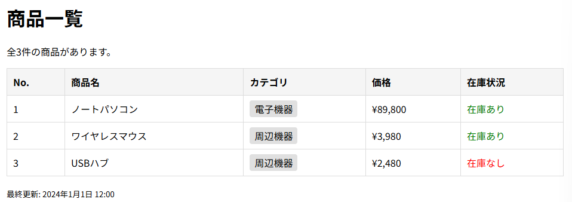

# blade-app-practice

## 概要
COACHTECH 教材 Tutorial 9-2「Bladeテンプレート ハンズオン演習」で作成した成果物です。

laravelを使った商品一覧を作成しました。

## 使用技術
PHP 8.2 
Laravel 10.x 
Blade テンプレート

## 学んだこと
・MVCの仕組みを理解することが出来たが、Routeやコントロールの書き方を理解出来ておらず、作成するのは難しかった。 
・自分で作った段階では404NotFoundが続き、sampleを確認して修正した。 
・変数を探すのが難しかった。どれが必要なのか、よく確認する必要がある。

## 動作確認
ブラウザを開いて確認したかったが、作成段階では上手く表示させることが出来なかった。
 
 
